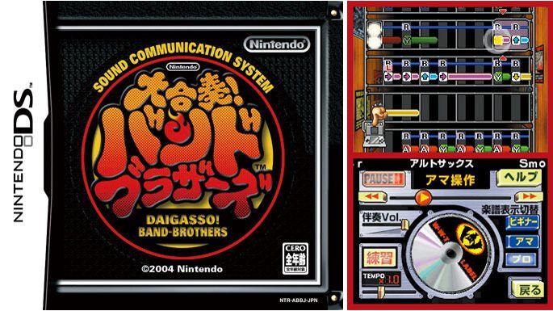
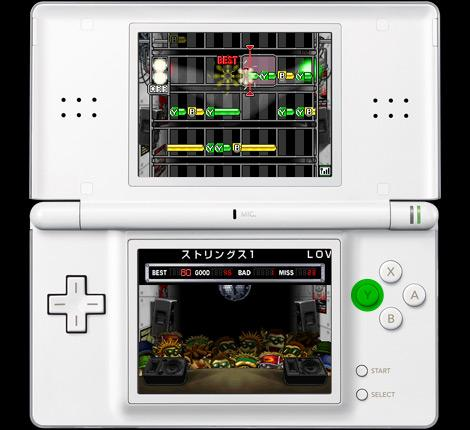
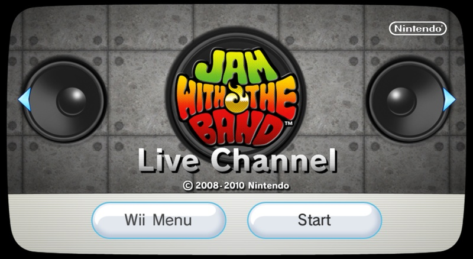
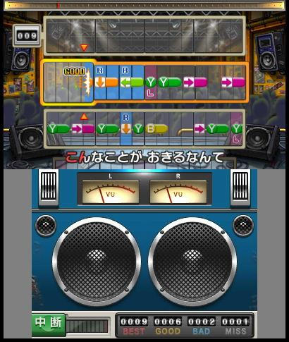
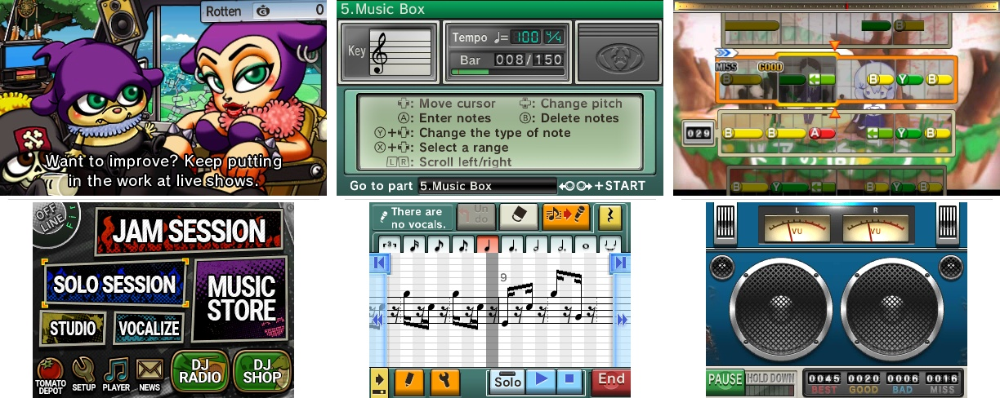

> Earn points on music arrangement for two decades? (5)

<!--more-->

It was 2006 when I discovered _Daigasso! Band Brothers_ for the first time. I was a young NSF at the time, and had saved up for months for a Nintendo DS Lite. (And an R4DS, but let's not go there.)

{: .align-center}

I was absolutely hooked! Daigasso's song catalogue was quite limited, but it had plenty of J-pop and anime music, which I was really into at the time. Needless to say I played the hell out of this game. I think I scored 99 on most songs/instruments. Not 100, which left absolutely no room for errors. Apparently 100 was possible, but I wasn't _that_ obsessed.

Or was I?

_Band Brothers DX_ was released as a sequel in 2008, and came with a massive library of downloadable songs. Again, there was a lot of J-pop and anime music. Each cartridge could only download 100 songs though, so I actually imported two cartridges from Japan. Eventually I reverse-engineered the save files and wrote DX Degausser to import/export songs and share with the community.

{: .align-center}

DX was (and continues to be) the only game in the series to get an official English version, released in 2010 as _Jam with the Band_. It never really caught on, but I personally thought that the Wii channel was the best thing ever. As a family, we must have played _Jam with the Band_ for countless hours over the Wii channel, just singing and jamming to random songs.

{: .align-center}

_Band Brothers P_ arrived in 2013 to much fanfare. It was released for the 3DS, which of course was how I got into the 3DS hacking scene. I jumped on this game early, reverse-engineering the BBP format and developing new versions of Degausser for Windows and the 3DS. The `.bbp` format became the de facto standard for sharing songs within the community, and I dare say there are over ten thousand BBPs in circulation today.

{: .align-center}

By then, I had had four semesters of Japanese study under my belt, so I set out on an ambitious quest to fan-translate the game! I joined the fan translation group FTI, where I learnt a lot about game translation. I helped to release many of their projects. But the _Band Brothers P_ fan-translation kept getting delayed, and never saw the light of day.

Until now.

Today, we're finally releasing our English translation of the game: _Jam with the Band P_! The project started in 2016 and took us over 10 years to reach the finish line, but here we are!

See the [GBAtemp release announcement](https://gbatemp.net/threads/wip-daigasso-band-brothers-p-fan-translation.430758/post-10947092) and [translation repo](https://github.com/Neobeo/JamWithTheBandP-English). Alongside the translation, I also released [Degausser 3.0](https://github.com/AdibSurani/Degausser) with a whole bunch of new features.

These days, my kids are obsessed with _Rhythm Heaven_. They've even learnt how to play the older games on GBA and Wii emulators, just so they could play more of it. One day I'll get them obsessed with Daigasso as well >:D

Speaking of, it's unfortunate that there hasn't been a Switch version of Daigasso. I'd love to play it on modern hardware without needing to maintain a collection of ageing 3DS consoles. I've purchased _Tomo Jam_ but it doesn't quite scratch the same itch for me -- maybe it's nostalgia for the enormous J-pop catalogue I've come to love. So maybe that could be my next project? But that's a story for another day.

For now it's nice to reflect back on the unintentional journey that Daigasso has taken me through: C#/WPF, DS/3DS gamehacking, game translation, and I dare say this is how I eventually got into competitive CTFs. All because I wanted to play more songs.

Happy 13th anniversary, _Daigasso! Band Brothers P_!

P.S. The opening clue is a triple definition. Did you get all three?

*[NSF]: Full-time National Serviceman
*[FTI]: Fan Translators International
